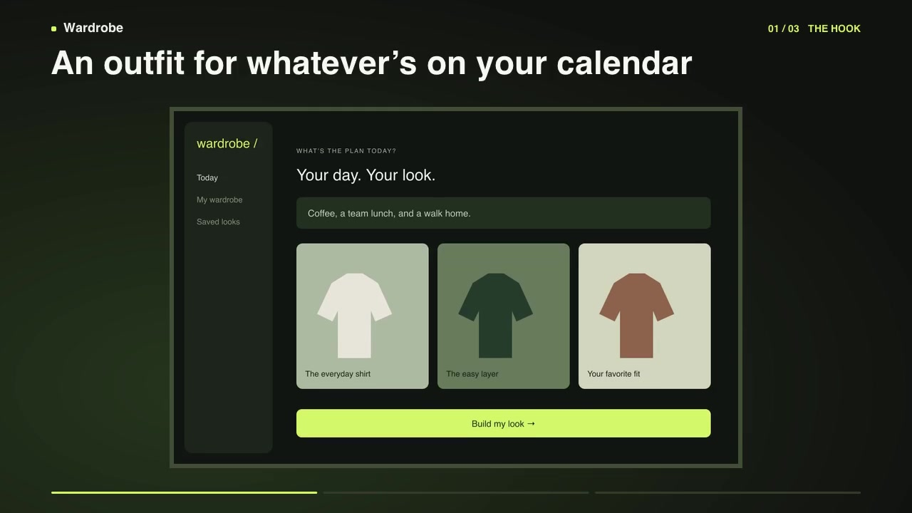

# DemoFork

DemoFork turns a reference video, three product screenshots, and a short description into a downloadable launch MP4. The reference sets the pace. The three screenshots become a hook, walkthrough, and payoff.

[Try DemoFork](https://demofork-psi.vercel.app/) · [Watch the sample](public/sample/demo.mp4)



## Run locally

Use Node.js 22.9+.

```sh
npm ci
npm run dev
```

Open [localhost:3000](http://localhost:3000). Choose **Load example** to try the whole flow, or add your own files:

1. Upload a 3–30 second MP4 or MOV, up to 40 MB.
2. Add a product name, a short description, and three JPG or PNG screenshots in story order. Each screenshot can be up to 8 MB.
3. Adjust the suggested captions if needed. Select **Generate demo**, then **Download MP4**.

The default renderer needs no API key. To enable the optional Magic Hour renderer, copy `.env.example` to `.env.local`, set `DEMOFORK_MOTION=magic-hour`, and supply `MAGIC_HOUR_API_KEY`.

## How it works

Next.js handles uploads and streams render progress. FFprobe reads the reference duration and dimensions. DemoFork maps that timing into a three-scene edit, then Sharp and FFmpeg frame, animate, caption, and stitch the uploaded screenshots. Export is a silent, fast-start H.264 MP4 at 30 fps. The first screenshot determines landscape, square, or portrait framing.

The reference footage stays out of the exported video. The default renderer preserves the full screenshot in each scene. Suggested captions use lightweight templates and the product description. The caption editor lets you set the exact wording. Magic Hour mode uses its image-to-video API for motion.

## Deploy to Vercel

Import the repository and attach a **private Vercel Blob store** to the project. Vercel supplies `BLOB_READ_WRITE_TOKEN`. Enable Fluid compute for the Node.js function. Large uploads go directly to private Blob storage, then the server deletes the staged files after reading them. Rendering runs within the request, so keep the page open until the MP4 is ready.

## Verify

```sh
npm test
npm run build
```

The test suite covers upload limits, timing, captions, provider polling, and the screenshot-to-MP4 pipeline. Tests use local fixtures. For a live smoke test against a deployed site with Blob uploads configured:

```sh
node --import tsx scripts/verify-hosted.ts https://demofork-psi.vercel.app --real
```

This exercises the configured renderer and saves the MP4 under `examples/`. With Magic Hour enabled, a smoke test uses three renders.

The bundled Wardrobe example is synthetic. Regenerate its screenshots, video, and poster with `node --import tsx scripts/build-sample.ts`.

The bundled Roboto Bold font uses Apache 2.0. See [the font license](assets/fonts/Roboto-LICENSE.txt).
